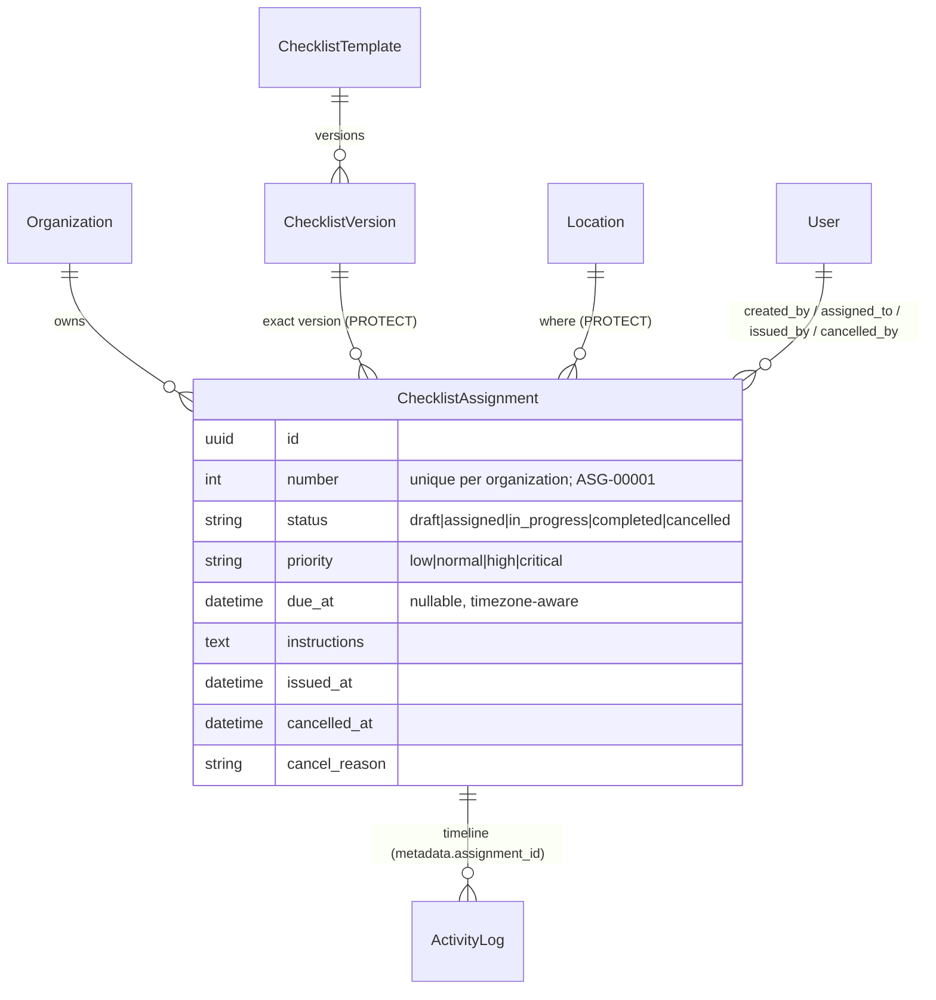

# Checklist assignment architecture (Phase 8)

An **assignment** says: *this exact published checklist version must be done at this location, by this deadline, with this priority.*
It is the bridge between the checklist engine (Phases 4-7) and the execution engine (Phase 9). It is generic: a "restaurant" is
just a location of some type; nothing here is specific to an organization or a checklist.

## Data model

* The assignment references the **exact `ChecklistVersion`**, never "the latest". A later version never changes what an existing
  assignment uses (see [checklist-versioning.md](checklist-versioning.md)); an assignment is a commitment to that version.
* `organization`, `version` and `location` are `PROTECT` foreign keys: neither a version nor a location can be deleted out from
  under an assignment. Assignments themselves are never deleted once issued (trigger).
* Locations are the generic hierarchy of Phase 2/3. "Assign to a restaurant" and "assign to a warehouse" are the same operation.

## Layers

| Layer | Module | Responsibility |
|---|---|---|
| Domain | `constants.py`, `models.py` | vocabulary, transition table, constraints, derived `effective_status` |
| Policies | `policies.py` | RBAC questions ("may this user issue here?") - thin wrappers over `has_permission` |
| Selectors | `selectors.py` | authorized, optimized read queries; summary; targets expansion |
| Services | `services/` | the **only** write path: validate, authorize, lock, persist, audit, emit events |
| Events | `events.py` | signals for future notification delivery (no receivers in Phase 8) |
| Guards | `guards.py` | PostgreSQL trigger for what CHECK constraints cannot express |
| Adapters | `views.py`, `api/v1/assignments.py`, `admin.py` | HTTP/UI/admin; no business rules of their own |

Views fetch the object through the **selector** (an invisible assignment is a 404) and then call the **service** (which enforces
the permission, a 403). The REST API uses the same two layers; the admin is read-only.

## Where each rule lives

| Rule | Service | Database |
|---|---|---|
| One open assignment per version + location | `validation.check_duplicate` (clear message) | partial unique index `one_open_assignment_per_version_location` (race-proof) |
| Version eligibility (current published version of an active, non-archived template; integrity not mismatched) | `validation.validate_target` via `checklists.lifecycle.assert_assignable` | - |
| Organization of version/template/location equals the assignment's | `validate_target` | trigger `assignments_guard` |
| Valid status / priority | transition table | CHECK constraints |
| Issued/cancelled bookkeeping consistent | services set it together | CHECK `assignment_lifecycle_consistent` |
| Version/location frozen after draft | `update_draft` only for drafts | trigger |
| Unique readable number per organization | `next_number` under the organization lock | unique constraint |

## Numbering

`ASG-00001` is `number` rendered with five digits; numbers are allocated **per organization** under a row lock on the
organization, so concurrent creators never collide (the unique constraint is the backstop). The reference is for people; the
UUID is the identity in URLs and the API.

## Integration points (not implemented here)

* **Notifications** - `events.py` defines `assignment_issued / cancelled / reopened / assignee_changed / due_changed /
  priority_changed`, sent **on commit** through `send_on_commit`. Phase 8 registers no receivers, so nothing is delivered; a later
  phase connects a receiver without touching the services.
* **Execution (Phase 9)** - an execution starts *from* an issued assignment and is the only thing allowed to move it to
  `in_progress` / `completed`. The persisted statuses and the open-assignment index already account for them.
* **Scheduling/recurrence** - an out-of-scope later layer creates assignments by calling `create_assignment`; every rule above
  applies unchanged.
* **Reports** - `selectors.summary` and the filterable queryset are the building blocks.

## Limitations

* Superseded versions are **not** assignable (no exception mechanism); archive/supersede the old assignment and issue the new
  version instead.
* The partial unique index covers *open* assignments (`assigned`, `in_progress`); drafts are not counted by the database, only
  by the service (so a draft is a harmless note until issued).
* Like the checklist guards (ADR 0049), the trigger cannot stop a database superuser or `TRUNCATE`.
* No import/export: assignments are operational records produced by a validated workflow, and a spreadsheet round-trip would
  bypass the lifecycle. Use the API or bulk assignment.
