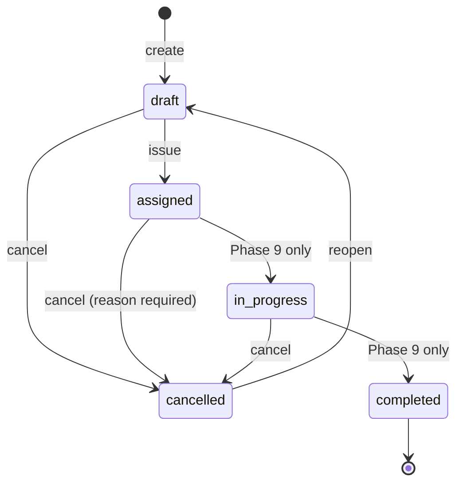

# Checklist assignment lifecycle

## Persisted vs. derived status

| Status | Stored? | Meaning |
|---|---|---|
| `draft` | yes | prepared, not yet visible to the responsible user; may be edited |
| `assigned` | yes | issued; open work |
| `in_progress` | yes | **reserved for Phase 9** - set only by a real execution |
| `completed` | yes | **reserved for Phase 9** - only a real, finished execution may set it |
| `cancelled` | yes | withdrawn; kept for history with who/when/why |
| `overdue` | **no** | *derived*: an open assignment whose `due_at` has passed |

`effective_status` returns `overdue` for an open, past-due assignment and the stored status otherwise. Because it is derived from
the clock, no background job can miss it, and moving the due date forward (or cancelling) clears it instantly. The list's
Overdue filter, the summary and the badges all use the same selector. "Due soon" is `due_at` within
`ASSIGNMENT_DUE_SOON_HOURS` (default 48) and not yet overdue.

**Nothing can fake completion.** No form, serializer, import or admin screen accepts `status`; the API rejects it with a 400.

## Operations

| Operation | From | To | Permission | Notes |
|---|---|---|---|---|
| create | - | `draft` (or `assigned` with `issue=true`) | `assignment.create` at the location | validates version eligibility, duplicate, due date, responsible user |
| edit draft | `draft` | `draft` | `assignment.update` | the only place version/location can change |
| issue | `draft` | `assigned` | `assignment.issue` | **revalidates everything** (the version may have been superseded since the draft was saved) |
| cancel | `draft`, `assigned`, `in_progress` | `cancelled` | `assignment.cancel` | a reason is mandatory; records who/when/why |
| reopen | `cancelled` | `draft` | `assignment.reopen` | clears the cancellation bookkeeping; issuing again revalidates |
| change responsible user / due date / priority | open (and draft) | same | `assignment.update` | each is individually audited |

Repeating a request is safe and explicit: issuing an issued assignment or cancelling a cancelled one is an
`AssignmentConflict` (HTTP 409, `already_issued` / `already_cancelled`) and changes nothing. A transition the table does not
allow (for example reopening a draft) is an `invalid_transition` error (HTTP 400) and is recorded as
`assignment.transition_refused`.

## Due dates and time zones

`due_at` is a timezone-aware UTC instant. The UI's `datetime-local` fields are read in the active time zone and stored in UTC;
the API accepts ISO-8601 with an offset. A due date must be in the future when it is set (creating, issuing, changing). It is
optional: an assignment without a deadline is never overdue. A date already past on an *existing* assignment is not rewritten -
that is exactly "overdue".

## Priority

`low < normal < high < critical`. Sorting by priority uses the annotated `priority_rank` (a real ordering, not alphabetical).

## Audit

Every state change writes an `ActivityLog` entry with the verbs `assignment.created / updated / issued / cancelled / reopened /
assignee_changed / due_changed / priority_changed / bulk_created / transition_refused`; `metadata.assignment_id` ties them to the
assignment, and the detail page and `GET /api/v1/assignments/{id}/history/` render that timeline. Model history
(`simple-history`) records every field change with the acting user.
