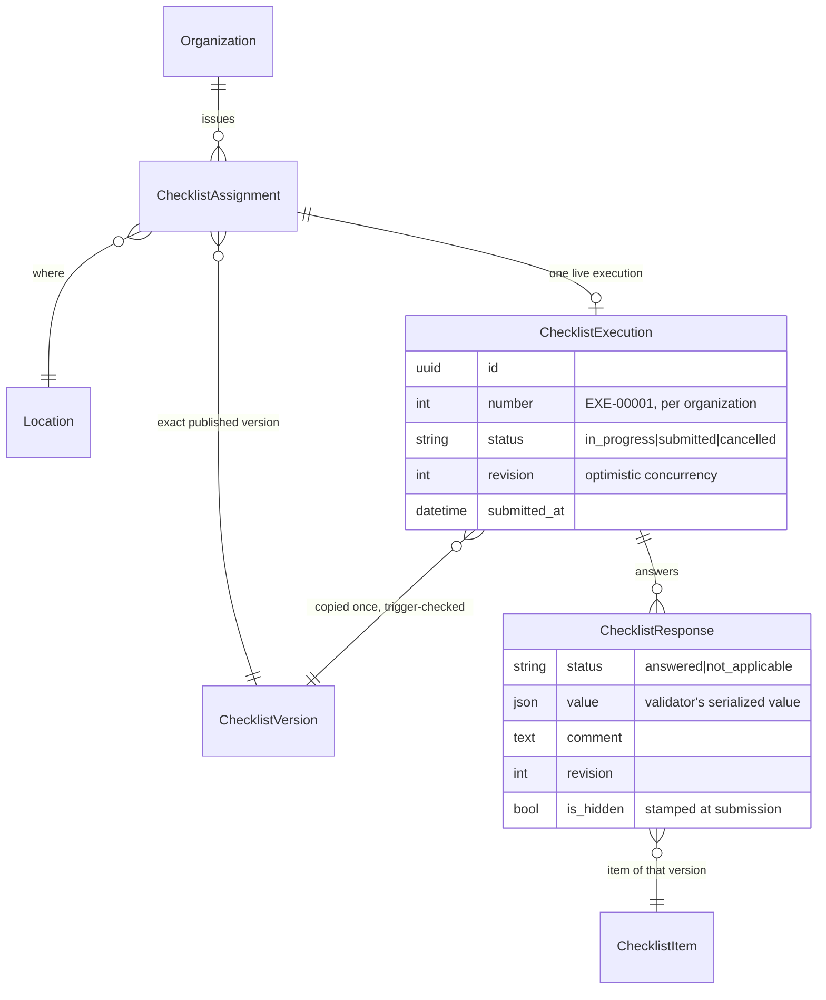

# Checklist execution architecture (Phase 9)

An **execution** is one user's attempt at one issued assignment. It is the runtime counterpart of the definition (Phases 4-7) and
the assignment (Phase 8). Nothing here is specific to restaurants: a restaurant, warehouse or office is just a `Location`.

`Organization -> ChecklistAssignment -> ChecklistVersion -> ChecklistExecution -> ChecklistResponse`. The execution references the
assignment and the immutable version; it copies **no** questions. `organization` and `version` are copied from the assignment once
at start only so integrity can be checked and scoped queries stay cheap; a PostgreSQL trigger (`apps/executions/guards.py`) keeps
them equal to the assignment's and forbids changing them. Editing a template, publishing a newer version or renaming a location
can never move a started execution.

## Layers

| Layer | Module | Responsibility |
|---|---|---|
| Domain | `constants.py`, `models.py` | statuses, constraints, one-live-execution index |
| Policies | `policies.py` | who may start / work / submit / cancel / view (calls the central RBAC service) |
| Selectors | `selectors.py` | authorized reads: `my_assignments`, `executions_visible_to`, `get_execution`, `timeline` |
| Services | `services/` | the **only** write path: `lifecycle`, `responses`, `validation`, `evaluation`, `progress`, `submission` |
| Guards | `guards.py` | PostgreSQL triggers (identity, frozen responses of a submitted execution) |
| Adapters | `views.py`, `api/v1/executions.py`, `admin.py` | HTTP / UI / admin: no business rules of their own |

The HTML workspace and the REST API call the same services, so validation, rule evaluation, progress and submission exist once.

## Services at a glance

| Service | Entry points | Notes |
|---|---|---|
| Lifecycle | `start_or_resume`, `cancel_execution`, `cancel_for_assignment` (hook) | assignment row lock; idempotent start |
| Responses | `save_answers`, `save_answer` | execution row lock, per-response revisions, partial batches |
| Validation | `submission_problems`, `describe` | Phase 5 validators inside the Phase 6 evaluation |
| Evaluation | `build_state` | stored answers -> `evaluate()` -> per-item visibility, requiredness, options, constraints |
| Progress | `compute_progress`, `progress_for_executions` | shared by UI, API and the worklist |
| Submission | `review`, `submit` | one transaction, idempotent |

Lock order is always **assignment -> execution**; saves lock only the execution. A hook (`apps/assignments/hooks.py`) lets the
executions app take part in an assignment cancellation without the assignments app importing it.

## Extension points (not implemented here)

* `events.py`: `execution_started / submitted / cancelled`, sent after commit; no receivers yet (notifications, findings,
  scoring and offline sync attach here without touching the services).
* Evidence storage (Phase 11): media answer types are refused today (see [response-validation.md](response-validation.md)).
* Offline execution (Phase 10): the answer contract and the revision tokens are the sync boundary.

## Limitations

* No reopen or correction of a submitted execution (a correction needs a later, explicitly authorized workflow).
* Photo / file / signature answers cannot be captured; a required one blocks submission.
* Progress is an operational indicator, not a score.
* The database triggers cannot stop a database superuser or `TRUNCATE`.
