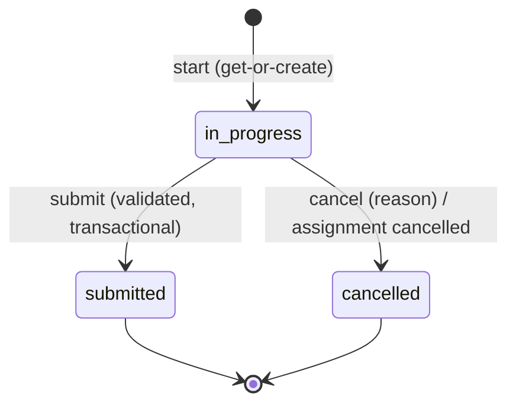

# Checklist execution lifecycle

| Status | Editable | Meaning |
|---|---|---|
| `in_progress` | yes | answers can be saved; one per assignment |
| `submitted` | **no** | final and read-only (also at the database) |
| `cancelled` | no | kept for history, answers preserved; frees the assignment's execution slot |

There is no `draft` (it would equal `in_progress`) and no `verified` / `closed` (later review phases).

## Three separate concepts

| Concept | Meaning | Changed by |
|---|---|---|
| Assignment | work that was issued (`assigned`, `in_progress`, `completed`, `cancelled`, derived `overdue`) | `assignments.services.lifecycle` only |
| Execution | one attempt at that work | `executions.services` only |
| Response | the answer to one item | `executions.services.responses` only |

## Start / resume

`start_or_resume(assignment, actor)` locks the assignment row, checks authorization (403) and then:

1. returns the assignment's live execution if there is one - in progress **or submitted** (a new execution is never created after
   submission, and a repeated or concurrent start never creates a second one);
2. otherwise requires the assignment to be `assigned` / `in_progress` (overdue work stays executable) and its version's
   integrity not to mismatch;
3. creates the execution, then asks the assignment lifecycle to move `assigned -> in_progress`.

Database: a partial unique index allows one `in_progress` or `submitted` execution per assignment.

## Assignment integration

| Event | Assignment |
|---|---|
| execution started | `assigned -> in_progress` (`mark_in_progress`) |
| execution submitted | `in_progress -> completed` (`mark_completed`) |
| execution cancelled by a user | `in_progress -> assigned` (`mark_released`) - the work is open again |
| assignment cancelled while an execution is in progress | the execution is cancelled in the same transaction, answers kept |

These transitions live in `SYSTEM_TRANSITIONS`, deliberately **not** in the user-facing `TRANSITIONS`: no form, API payload, import
or admin screen can request them. Saving a draft never completes anything. A completed assignment cannot be cancelled.

## Cancellation

`execution.cancel` is required (not granted to ordinary runners). A reason is mandatory. Cancelling a cancelled execution is a
conflict (409), cancelling a submitted one is refused.

## Not supported

Reopening a submitted execution: a normal user can never reset it, and no privileged path exists in Phase 9 (documented
limitation, see [execution-submission.md](execution-submission.md)).
