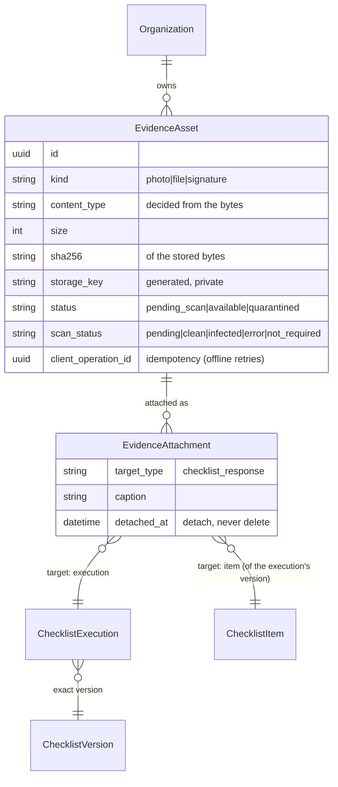

# Evidence & attachments architecture (Phase 11)

Evidence is a **reusable, private, auditable platform capability**: files (photos, documents, signatures) that belong to a business
record. Today the record is a checklist response (one item of one execution); findings, corrective actions and verifications will plug
in through the [target registry](evidence-attachment-targets.md) without redesigning anything here.

## Models (apps/evidence)

| Model | Purpose |
|---|---|
| `EvidenceAsset` | the stored file and its verified facts. Immutable facts (organization, hash, size, key, type, uploader) are protected by a database trigger; only status/scan fields move, through the lifecycle service. |
| `EvidenceAttachment` | links an asset to an approved target with **explicit foreign keys** (no `GenericForeignKey`): a checklist response is `(execution, item)`. One live attachment per asset and target; detaching fills `detached_*` and keeps the row. |

There is no separate upload-session table: a staged upload protocol is not needed (one request carries the file, ≤ 10 MB), and
idempotency is a unique `(uploaded_by, client_operation_id)` on the asset - a retry of the same operation returns the original attachment.
Binary data is **never** stored in PostgreSQL.

## Layers

| Layer | Module | Responsibility |
|---|---|---|
| Validation | `validation.py` | pure functions: extension allow-list, real type from bytes, image re-encode (EXIF/GPS and appended payloads removed), PDF structure + active-content refusal, size/pixel limits, hash |
| Storage | `storage.py` | `EvidenceStorage` interface + private filesystem backend; generated keys, traversal-proof, atomic writes |
| Scanning | `scanning.py` | `Scanner` interface, ClamAV adapter, safe default, EICAR test double |
| Lifecycle | `lifecycle.py` | the only place an asset changes status; audited; quarantined is final |
| Targets | `targets.py` | registry that resolves, authorizes and state-checks a target |
| Services | `services.py` | `upload`, `attach_existing`, `detach`, `read_bytes` - authorization, validation, transactions, compensation, audit |
| Selectors | `selectors.py` | visibility is derived from the *target*: you see a file iff you can see what it is attached to |
| Adapters | `views.py`, `api/v1/evidence.py`, `admin.py` | CBVs, DRF, read-only admin |

## Integration

* **Phase 5 (answer types):** `photo` / `file` / `signature` answers are *derived from the attached, available files* and validated by the
  existing Phase 5 normalizers (allowed extensions, max files, size). Nothing is typed in; a typed media value is refused
  (`use_evidence_upload`).
* **Phase 6 (rules):** `REQUIRE_EVIDENCE` is evaluated against the same derived data. Only **available** (scanned, verified) files count;
  pending, quarantined and detached files do not, and the submission message says why.
* **Phase 9 (execution):** uploads are allowed only while the execution is `in_progress` and the user may work on it; under the execution
  row lock (the same lock saves and submission take) so a submit cannot race an upload. Submission re-validates evidence from the database.
  After submission evidence is read-only; the execution stays reproducible (exact version, exact files).
* **Phase 10 (offline):** the device stores the Blob in IndexedDB and uploads it through the *same* endpoint with a stable operation id
  ([offline-evidence-sync.md](offline-evidence-sync.md)).

See also: [upload pipeline](evidence-upload-pipeline.md), [storage](evidence-storage.md), [malware scanning](evidence-malware-scanning.md),
[security and authorization](evidence-security-and-authorization.md), [operations](evidence-operations.md), [API](api/evidence.md).
