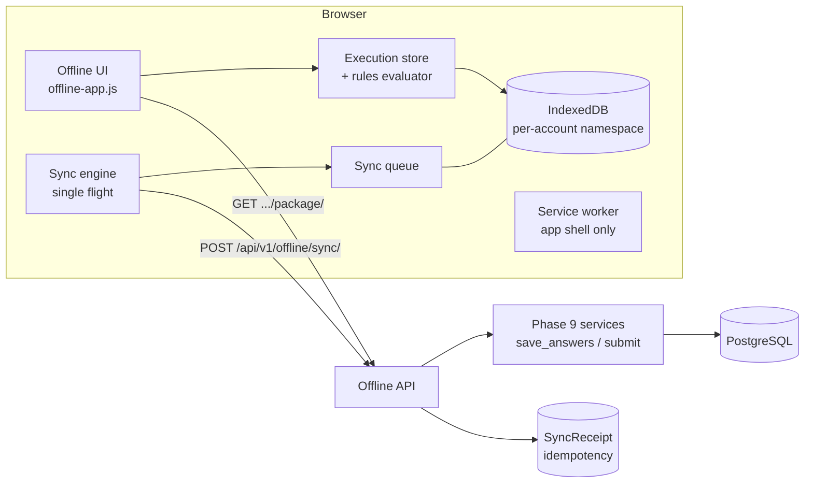

# PWA architecture (Phase 10)

The platform is an installable Progressive Web App with an **offline checklist workspace** that extends - never replaces - the Phase 9
execution engine. The server stays authoritative for identity, authorization, validation, rules, revisions and submission; the browser
holds a *cache* of a prepared assignment and a *queue of local intent*.

## Pieces

| Piece | Where | Purpose |
|---|---|---|
| Manifest | `templates/pwa/manifest.webmanifest`, `core:manifest` | name, icons, scope `/`, theme colours from the theme engine |
| Service worker | `static/js/service-worker.js` | precache the public app shell; strict allowlist ([service-worker-caching.md](service-worker-caching.md)) |
| Offline shell | `/offline/app/` (`templates/pwa/offline_app.html`) | public, data-free HTML that boots `offline-app.js` |
| Offline client | `static/js/offline/*.js` (native ES modules, no build step) | IndexedDB, rules evaluator, queue, sync engine, UI |
| Server protocol | `apps/executions/offline/`, `apps/api/v1/offline.py` | package, manifest, sync, conflict resolution, session |
| Idempotency | `SyncReceipt` (apps/executions) | durable record of processed operations |

## Trust boundaries

1. IndexedDB, Cache Storage and `localStorage` are **untrusted** (user-editable, readable by anyone using the profile). Every local
   record is validated before use (`schema.js`) and is either a copy of something the server said or a local intent.
2. Nothing local is proof of anything: not an assignment, a role, a permission, an answer's validity, a timestamp or a status. At sync
   the server re-authorizes, re-validates, re-evaluates rules and checks revisions for **every operation**.
3. Identity is asserted by the server (`GET /api/v1/offline/session/`) whenever the device is online; offline, only the last account
   that has not signed out can open its own namespace, and the UI says "identity not verified".

## Offline readiness states

Online / Offline / Checking connection (real request outcomes, not `navigator.onLine`), *Ready for offline use*, *Preparing* (staging
record only - never ready), *N changes waiting to synchronize*, *Synchronizing*, *Synchronization failed - will retry*, *N conflicts need
attention*, *Sign in to synchronize*, *Different account signed in*.

## Supported / limited

Supported offline: every answer type (boolean, yes/no, yes/no/N-A, single/multiple choice, score, numeric, text, long
text, date, date-time, matrix), sections, progress, comments, and the rule features listed in
[offline-execution.md](offline-execution.md). Photo / file / signature work offline since Phase 11 (Blobs in the `evidence` store, see
[offline-evidence-sync.md](offline-evidence-sync.md)). Not available offline:
checklists whose rules the client evaluator does not implement - those are **refused at preparation** with the reason, never degraded
silently.

## Browser requirements

HTTPS (or `localhost`) for service workers; IndexedDB; `fetch`; ES modules. Optional: Background Sync (Chromium), Web Locks (cross-tab
single-flight; without it only same-tab single-flight applies), `beforeinstallprompt` (Chromium install button; on iOS use *Add to Home
Screen*). Safari may evict origin storage after a period of non-use - synchronize regularly.

## Deployment

* Serve over HTTPS; `/service-worker.js` must be reachable from the site root without redirects and keep `Cache-Control: no-cache`.
* Run `collectstatic` (the offline modules are plain static files; the precache list is checked by a test against `static/js/offline`).
* CSP stays strict: module scripts load from `'self'`; there is no inline script.
* Optional environment: `API_THROTTLE_OFFLINE_SYNC` (default `120/min`). Schedule `prune_sync_receipts` (default 90 days).
